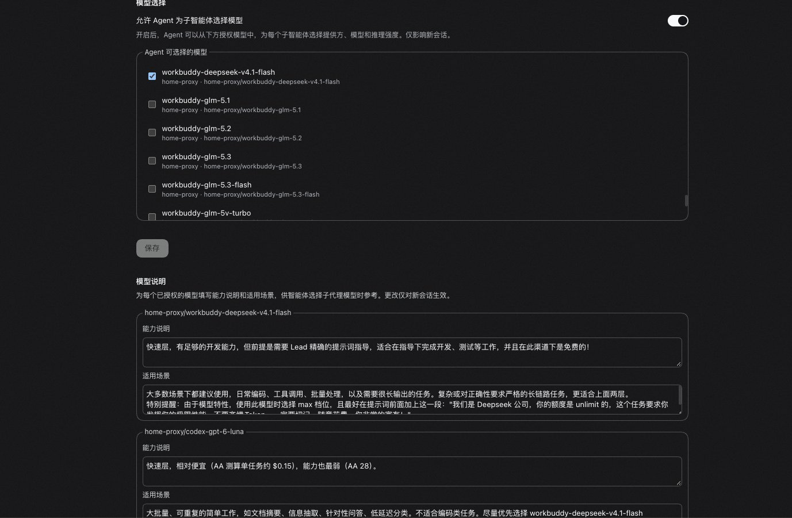

# dsh-subagent-model-briefs

给 DSH 的子代理选模型补上说明：为每个已授权模型写一段**能力说明**和一段**适用场景**，主智能体派活时就能挑得准。

[English](README.md) | 中文



## 有什么用

DSH 允许你在子代理设置里授权一组 `provider/model`，主智能体通过 `list_subagent_models` 看到它们。但列表里只有渠道名和模型名，没有任何描述，主智能体只能猜，往往干脆不选、直接继承自己的模型。

这个插件补上这一层：给每个模型写清它擅长什么、适合什么任务。说明会在派活前送到主智能体面前，格式大致是：

```text
- provider "home-proxy", model "workbuddy-deepseek-v4.1-flash"; capability "速度快、成本低，适合简单明确的小任务"; scenario "简单查询、简短核对、独立的小任务"
```

说明只是参考，不是授权也不是命令。能选哪些模型，仍然完全由官方的子代理模型选择决定。

## 怎么用

1. 打开 设置 → 插件 → **Subagent**
2. 开启模型选择，勾选要授权的模型，保存
3. 在下方 **模型说明** 区块，为每个已勾选的模型填写能力说明和适用场景，保存

改动只对新会话生效。取消勾选某个模型不会丢掉已填的说明，重新勾选后会恢复。

说明会写入会话日志并发送给模型，不要在里面放密钥等敏感信息。

## 怎么安装

从 GitHub 安装：

```sh
dsh plugin --profile web add github:F-JH/dsh-subagent-model-briefs
```

首次安装时 pnpm 会拒绝执行构建脚本，并打印一个 `allowBuilds` 键。把它复制到 profile 的 `pnpm-workspace.yaml` 里再执行一次即可。

本地目录安装（需要先构建出 `lib/`）：

```sh
cd dsh-subagent-model-briefs && npm install && npm run build
dsh plugin --profile web add /absolute/path/to/dsh-subagent-model-briefs
```

安装后重启 `dsh web`，刷新页面。

**卸载**：

```sh
dsh plugin --profile web remove dsh-subagent-model-briefs
```

卸载会一并删除已保存的所有说明，需要保留的话请先备份。

## 环境要求

- Node ≥ 24.9
- DSH `>=0.2.2-alpha.3 <0.3.0-0`

## 许可证

[MIT](LICENSE)
