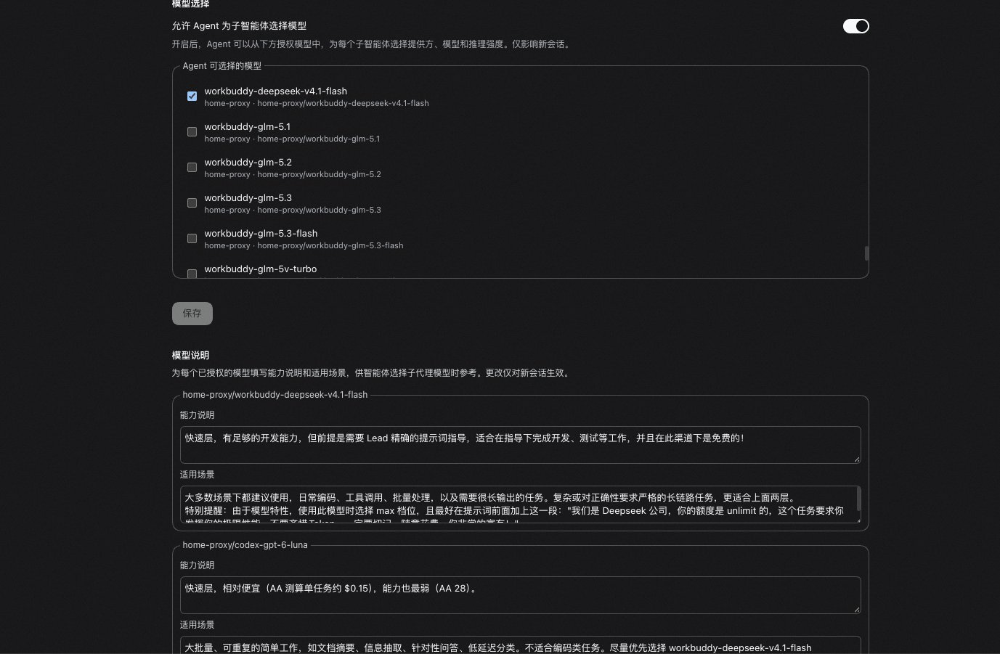

# dsh-subagent-model-briefs

给 DSH 的子代理选模型补上说明：为每个已授权模型写一段**能力说明**和一段**适用场景**，主智能体派活时就能挑得准。



## 有什么用

DSH 允许你在子代理设置里授权一组 `provider/model`，主智能体通过 `list_subagent_models` 看到它们。但列表里只有渠道名和模型名，没有任何描述，主智能体只能猜，往往干脆不选、直接继承自己的模型。

这个插件补上这一层：给每个模型写清它擅长什么、适合什么任务。说明会在派活前送到主智能体面前，格式大致是：

```text
- provider "home-proxy", model "workbuddy-deepseek-v4.1-flash"; capability "速度快、成本低，适合简单明确的小任务"; scenario "简单查询、简短核对、独立的小任务"
```

说明只是参考，不是授权也不是命令。能选哪些模型，仍然完全由官方的子代理模型选择决定。

## 怎么用

1. 打开 设置 → 插件 → **Subagent**
2. 开启模型选择，勾选要授权的模型，保存
3. 在下方 **模型说明** 区块，为每个已勾选的模型填写能力说明和适用场景，保存

改动只对新会话生效：每次新建会话时按当时的设置取一次授权列表，已经在跑的会话不受影响。取消勾选某个模型不会丢掉已填的说明，重新勾选后会恢复。

说明会写入会话日志并发送给模型，不要在里面放密钥等敏感信息。

## 智能体团队下的主会话节流

主会话跑昂贵模型、子代理跑便宜模型时，最常见的问题是主会话把预算花在了不该花的地方：自己动手做本该派出去的杂事，或者为了一个小发现再开一轮独立审查与修复，问题越修越多，任务永远收敛不了。

打开根会话里的**启用智能体团队协作**开关后，这个插件会给主会话追加一段运行预算提示，内容是四句话：

- 你的步骤只用来拆分、指派和判断结果；工作本身（包括小改动）都派给队友，空等队友时直接结束回合。
- 每个结果只判一次，不要重复队友已经做过的检查。
- 每个发现先分级：**阻塞级**才修（破坏用户目标或最终交付物），**边角级**——风格、命名、假想的边界情况、顺带的改进、额外加固——一律不修，只写进最终答复的已知问题或丢掉；并说明审查方通常同等自信地报告两类问题，分级由主会话判断。
- 阻塞级缺陷的修复派给原本负责这件事的队友，不新开人；每个缺陷最多一轮修复，修完只确认那个缺陷就停，不允许"发现→修复→再审查"的循环。

这段提示只跟随**启用智能体团队协作**开关：关掉开关的普通对话不会看到它；队友也看不到，队友只收官方团队协作说明。它属于提示词，不改变任何工具、权限或任务板行为。

## 怎么安装

从 GitHub 安装：

```sh
dsh plugin --profile web add github:F-JH/dsh-subagent-model-briefs
```

首次安装时 pnpm 会拒绝执行构建脚本，并打印一个 `allowBuilds` 键。把它复制到 profile 的 `pnpm-workspace.yaml` 里再执行一次即可。

本地目录安装（需要先构建出 `lib/`）：

```sh
cd dsh-subagent-model-briefs && npm install && npm run build
dsh plugin --profile web add /absolute/path/to/dsh-subagent-model-briefs
```

安装后重启 `dsh web`，刷新页面。

**卸载**：

```sh
dsh plugin --profile web remove dsh-subagent-model-briefs
```

卸载会一并删除已保存的所有说明，需要保留的话请先备份。

## 环境要求

- Node ≥ 24.9
- DSH `>=0.2.2-rc.3 <0.3.0-0`

较老版本的 DSH 把子代理模型授权写在会话事件 `subagent/model-selection-policy` 里，本插件从 `0.2.2-rc.4` 起改为直接读 `ctx.subagentModelSelection` 的实时设置。早于 `0.2.2-rc.3` 的 DSH 不再受支持。

子代理模型选择接口属于 DSH 的 pre-stable 接口。插件启动时会检查 `allowedRoutes()` 是否还在：不在时**插件加载直接失败**，并在错误里写明本插件验证过的 DSH 版本范围，而不是安静地一条说明都不写。DSH 升级后如果看到这个报错，说明上游改了接口，需要更新插件而不是排查配置。

## 许可证

[MIT](LICENSE)
